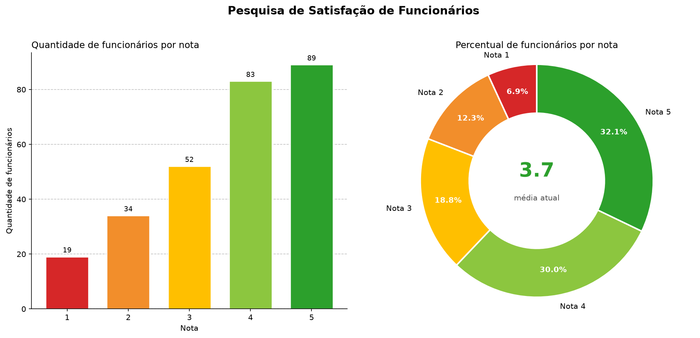

# 📊 Desafio 02 — Pesquisa de Satisfação de Funcionários

Análise da base histórica de satisfação da **Acme Corp**, com o objetivo de medir a percepção **atual** da equipe a partir da resposta mais recente de cada colaborador.



---

## 🎯 O Desafio

A Acme Corp aplica um formulário anual de satisfação desde 2019. Como a base acumulou ~900 respostas, um mesmo funcionário pode ter vários envios ao longo do tempo. A tarefa consiste em:

1. **Isolar a resposta mais recente** de cada funcionário.
2. **Contar quantos funcionários** se enquadram em cada nível de satisfação (1 a 5).

### Escala utilizada

| Nota | Categoria |
|:---:|---|
| 1 | Muito insatisfeito |
| 2 | Insatisfeito |
| 3 | Neutro |
| 4 | Satisfeito |
| 5 | Muito satisfeito |

---

## 📁 Estrutura do repositório

.
├── avaliacao_satisfacao.ipynb # Notebook com a análise completa
├── employee_satisfaction_survey.csv # Base de dados original
├── satisfacao_combinado.png # Dashboard (barras + donut)
└── README.md # Este arquivo


---

## ⚙️ Metodologia

A análise foi feita em **Python (Pandas)**, no notebook [`avaliacao_satisfacao.ipynb`](avaliacao_satisfacao.ipynb). As etapas foram:

1. **Carregamento e verificação** — shape, tipos, nulos e duplicatas.
2. **Conversão de data** — `Timestamp` convertido para `datetime` com `format='%Y-%m-%d %H:%M:%S'`.
3. **Filtro da resposta mais recente** — ordenação por data + `groupby('Email').tail(1)`, mantendo 1 linha por colaborador.
4. **Agregação** — contagem de funcionários e cálculo de porcentagem por nota.
5. **Indicadores** — média, distribuição e conclusão de negócio.
6. **Visualização** — dashboard combinado com gráfico de barras + donut com a média central.

---

## 📈 Resultados

### 1. Tabela Resumo

Base após filtro: **277 colaboradores** (de 901 respostas originais).

| Nota | Categoria | Quantidade | % |
|:---:|---|---:|---:|
| 1 | Muito insatisfeito | 19 | 6,86% |
| 2 | Insatisfeito | 34 | 12,27% |
| 3 | Neutro | 52 | 18,77% |
| 4 | Satisfeito | 83 | 29,96% |
| 5 | Muito satisfeito | 89 | 32,13% |
| | **Total** | **277** | **100%** |

### 2. Gráfico de Distribuição


> Gráfico de barras (quantidade por nota) + donut (percentual por nota) com a **média atual (3,7)** destacada no centro.

### 3. Conclusão de Negócio

- **Nota média atual:** **3,7 / 5**
- **Maioria satisfeita:** **62,1%** dos colaboradores deram notas **4 ou 5**.
- **Grupo neutro:** **18,8%** deram nota **3**.
- **Grupo insatisfeito:** **19,1%** deram notas **1 ou 2** — quase **1 em cada 5 colaboradores**.

**Interpretação:** a maioria dos funcionários está satisfeita com a empresa (notas 4 e 5). A média de 3,7/5 reforça essa percepção, mas o grupo de **insatisfeitos (19,1%)** é significativo o bastante para merecer atenção — especialmente porque 6,9% se declararam **muito insatisfeitos**, o que pode sinalizar pontos específicos de insatisfação a serem investigados.

---

## 🔬 Comprovação Técnica

### Filtro da resposta mais recente por colaborador

```python
avaliacao_recente = (
    dados_df
    .sort_values('Timestamp')
    .groupby('Email', as_index=False)
    .tail(1)
    .reset_index(drop=True)
) 
```

### Agregação por nota
```python
resumo = (
    avaliacao_recente
    .groupby('Satisfaction')
    .agg(Quantidade=('Email', 'count'))
    .reset_index()
)

resumo['Porcentagem'] = (
    resumo['Quantidade'] / resumo['Quantidade'].sum() * 100
).round(2)
```

### Média atual
```python
satisfacao_media = avaliacao_recente['Satisfaction'].mean()  # 3.7
```

> O notebook completo, com todas as células executadas e outputs, está em avaliacao_satisfacao.ipynb.

---
## 🚀 Como reproduzir

Requisitos: Python 3.10+ e as bibliotecas pandas e matplotlib.


Clone o repositório
```bash
git clone ttps://github.com/Johsep06/Pesquisa-de-Satisfacao-de-Funcionarios.git
```

```bash
cd Pesquisa-de-Satisfacao-de-Funcionarios
```

(Opcional) crie um ambiente virtual
```bash
python -m venv .venv
source .venv/bin/activate      # Linux/macOS
# .venv\Scripts\activate       # Windows
```

Instale as dependências
```bash
pip install -r requirements.txt
```

Abra o notebook
jupyter notebook avaliacao_satisfacao.ipynb


Ou rode diretamente no Google Colab / Jupyter.

---

## 🛠️ Tecnologias

| Ferramenta| Uso |
|---|---|
| Python | 3.14	Linguagem principal |
| Pandas | Manipulação e agregação dos dados |
| Matplotlib | Visualização (barras + donut) |
| Jupyter Notebook | Ambiente de análise |

---

## ✅ Checklist do desafio

- ☑ 1. Tabela Resumo — quantidade e porcentagem por nota
- ☑ 2. Gráfico de Distribuição — dashboard combinado (barras + donut)
- ☑ 3. Conclusão de Negócio — média 3,7/5 e predominância de satisfeitos (62,1%)
- ☑ 4. Comprovação Técnica — notebook com código + outputs + gráfico exportado

---

## 👤 Autor

<José R. Maciel P.>
- LinkedIn: [jose-maciel-developer](http://www.linkedin.com/in/jose-maciel-developer)
